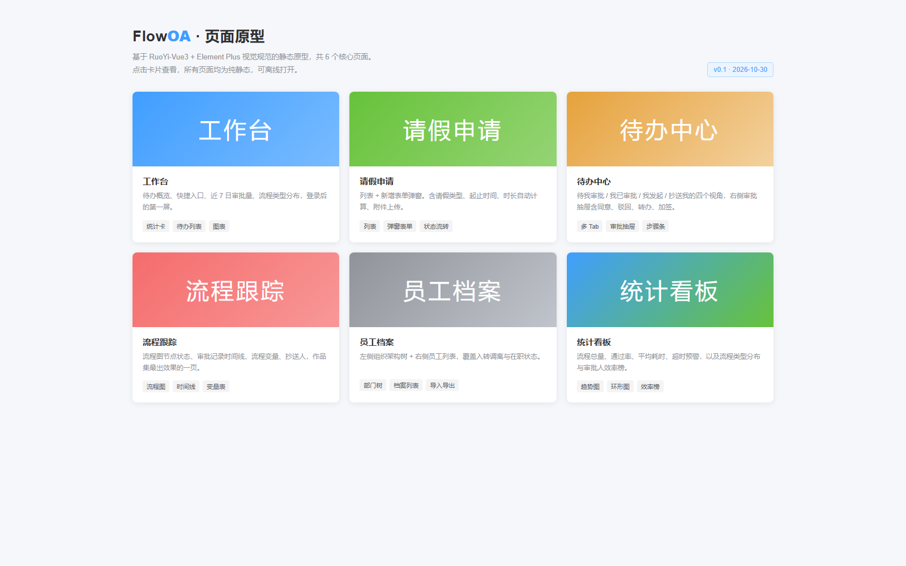
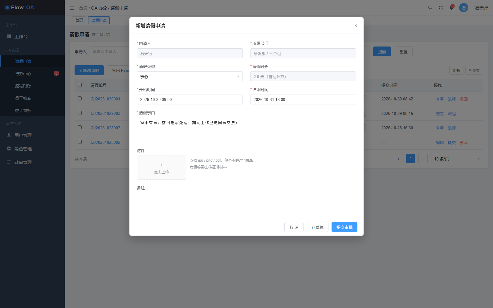

# RuoYi-OA · 轻量企业协同办公平台

基于 [若依 RuoYi-Vue 3.9.2](https://gitee.com/y_project/RuoYi-Vue) 二次开发、接入 **Flowable 6.7.2** 流程引擎的轻量 OA 系统。目前已完成**请假审批流程**的后端闭环（发起 → 部门负责人审批 → 人事备案 / 总经理审批 → 归档），前端沿用若依 Vue3 框架。

前后端已整合到本仓库：`server/`（后端）、`web/`（前端）。

## 功能

### 已实现（后端 `server/ruoyi-oa`）

| 能力 | 说明 |
|---|---|
| 请假单管理 | 增删改查、条件查询、Excel 导出 |
| 请假流程 | BPMN 定义（`leave_approval.bpmn20.xml`），按请假天数动态路由 |
| 流程流转 | 提交、审批通过、驳回、撤回；驳回按原流程实例退回 |
| 待办 / 已办 | 个人待办、已办任务列表 |
| 流程跟踪 | 查询流程节点进度，用于前端流程图展示 |
| 审批人解析 | 按角色自动解析审批人（`oaAssigneeResolver`），复用若依用户体系 |
| 基础数据 | `oa_leave` 表、`oa_leave_type` 字典、OA 菜单与按钮权限脚本 |

请假流程规则：`提交申请` → `部门负责人审批` → 请假 **> 1 天** 追加 `人事备案` → **> 3 天** 追加 `总经理审批` → 结束。

### 开箱即用的若依能力

用户 / 部门 / 岗位 / 角色 / 菜单 / 字典 / 参数 / 公告 / 操作日志 / 登录日志 / 定时任务 / 代码生成器 / 文件上传，数据权限、多数据源、接口限流等。

### 规划中

员工档案（入转调离）、报销 / 出差 / 加班申请、待办中心、ECharts 数据看板、bpmn-js 在线流程设计器、Docker Compose 部署。详见 [server/doc/OA-PLAN.md](server/doc/OA-PLAN.md)。

## 技术栈

**后端**

| 组件 | 版本 / 说明 |
|---|---|
| RuoYi-Vue | 3.9.2 |
| Spring Boot | 2.5.15 |
| Java | 8 |
| 流程引擎 | Flowable 6.7.2（`flowable-spring-boot-starter-process`，排除自带 IDM） |
| 持久层 | MyBatis + Druid |
| 鉴权 | Spring Security + JWT |
| 缓存 | Redis |
| 数据库 | MySQL |
| 定时任务 | Quartz |
| 构建 | Maven |

**前端**

| 组件 | 版本 |
|---|---|
| Vue | 3.5 |
| Element Plus | 2.13 |
| Pinia | 3.0 |
| Vue Router | 4.6 |
| Vite | 6.4 |
| ECharts | 5.6 |
| Axios | 1.13 |

## 目录结构

```
ruoyi-OA/
├── server/                     后端（RuoYi-Vue 3.9.2）
│   ├── ruoyi-admin/            启动模块：Web 入口与配置文件
│   ├── ruoyi-common/           通用工具、注解、常量
│   ├── ruoyi-framework/        安全、数据权限、多数据源
│   ├── ruoyi-system/           系统管理（用户/角色/菜单/字典…）
│   ├── ruoyi-quartz/           定时任务
│   ├── ruoyi-generator/        代码生成器
│   ├── ruoyi-oa/               ★ OA 业务模块：Flowable 集成、请假流程
│   ├── sql/                    数据库脚本（含 oa/01_oa_leave.sql）
│   └── doc/                    项目规划、审批语义设计、静态原型与截图
├── web/                        前端（RuoYi-Vue3 3.9.2）
│   ├── src/                    源码：api / views / router / store …
│   └── vite.config.js          开发服务器配置（端口 80，代理 /dev-api → 8080）
└── README.md
```

## 快速开始

### 1. 环境要求

- JDK 1.8、Maven 3.6+
- MySQL 5.7+ / 8.0
- Redis 5+
- Node.js 18+

### 2. 初始化数据库

```sql
CREATE DATABASE `ry-vue` DEFAULT CHARACTER SET utf8mb4 COLLATE utf8mb4_general_ci;
```

按顺序导入 `server/sql` 下的脚本：

| 脚本 | 内容 |
|---|---|
| `ry_20260417.sql` | 若依基础表与初始化数据（含 `admin` 账号） |
| `quartz.sql` | 定时任务相关表 |
| `oa/01_oa_leave.sql` | OA 请假单表、请假类型字典、OA 菜单与按钮权限 |

### 3. 启动后端

先修改配置：

- `server/ruoyi-admin/src/main/resources/application-druid.yml`：数据库地址、账号、密码（默认 `localhost:3306/ry-vue`，`root/123456`）
- `server/ruoyi-admin/src/main/resources/application.yml`：Redis 地址（默认 `localhost:6379`）

```bash
cd server
mvn clean package
java -jar ruoyi-admin/target/ruoyi-admin.jar
```

后端地址：<http://localhost:8080>

> 首次启动时 Flowable 会自动创建 `ACT_*` / `FLW_*` 表（`database-schema-update=true`），无需手工建表。
> 修改代码后请用 `mvn clean package`，避免增量打包导致 jar 仍是旧代码。

### 4. 启动前端

```bash
cd web
npm install
npm run dev
```

前端地址：<http://localhost:80>，开发环境 `/dev-api` 已代理到 `http://localhost:8080`。

### 5. 登录

默认账号：`admin` / `admin123`。

> 说明：OA 相关后端接口与菜单权限已就绪，登录后可在「OA 办公 → 请假申请」看到菜单；对应前端页面（`web/src/views/oa/leave/index`）尚待开发，界面设计可参考 `server/doc/prototype/` 下的静态原型。

## 文档与原型

| 文件 | 说明 |
|---|---|
| [server/doc/OA-PLAN.md](server/doc/OA-PLAN.md) | 项目规划：目标、架构、模块优先级、验收标准 |
| [server/doc/OA-审批语义设计.md](server/doc/OA-审批语义设计.md) | 审批状态机、按天路由、驳回退回、审批人解析 |
| `server/doc/prototype/` | 静态 HTML 原型（首页、请假、待办、跟踪、看板等）与截图 |
| `server/README.md`、`web/README.md` | 上游若依框架原始文档 |

原型截图：

| 首页 | 请假申请 |
|---|---|
|  |  |

## 说明

- 本项目基于若依 RuoYi-Vue / RuoYi-Vue3 3.9.2 二次开发，遵循其 MIT 协议（见 `server/LICENSE`），感谢若依团队。
- 配置中的数据库、Redis 账号密码均为本地开发默认值，部署前请务必替换。
- 后端模块 `ruoyi-oa` 通过 `RuntimeService / TaskService / HistoryService` 直接调用流程引擎，未做重度二次封装，便于阅读与扩展。

## License

MIT，见 [server/LICENSE](server/LICENSE)。
